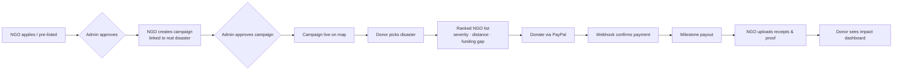

<div align="center">

# 🤝 ReliefTrack

### Give with confidence. Every NGO verified. Every rupee backed by proof.


[Problem](#-the-problem) • [Solution](#-the-solution) • [Priority Funding](#-priority-based-funding) • [Verification](#-how-we-verify-campaigns) • [Features](#-core-features) • [MVP](#-mvp-scope) • [Roadmap](#-limitations--roadmap)

</div>

---

## 🚨 The Problem

- **Donors** don't know which NGOs to trust or where their money actually goes.
- **NGOs** have no single place to raise funds and coordinate disaster relief.
- Donations tend to **pile up with a few well-known NGOs**, while smaller NGOs in badly hit areas are starved of funds.

## 💡 The Solution

**ReliefTrack** is one platform where **verified NGOs raise disaster relief funds through PayPal**, and **donors see proof of how the money was used**: receipts, photos and delivery confirmations.

---

## ⭐ Priority-Based Funding

> Our unique feature: donations go where they're needed most, not to whoever is most famous.

When a donor selects a disaster, they see a **ranked list of verified NGOs** instead of a random one, ordered by:

| Rank factor | What it means | Order |
|---|---|---|
| 🔥 **Severity** | How badly affected the area the NGO serves is | Worst-affected first |
| 📍 **Distance** | Distance from the NGO's relief base to the affected area | Nearest first |
| 💰 **Funding gap** | Funds raised vs. the NGO's goal | Least funded ranks higher |

Each NGO has a **funding cap**. Once it's full, donors are automatically moved to the next NGO on the list.

**Example:** a donor abroad picks a flood campaign and sees the verified NGOs nearest to the worst-hit area first, with the least-funded ones boosted. The donor doesn't need to know the local geography.

> 📌 The location in our demo is only a sample scenario. The logic works for any disaster and any region.

---

## 🏛️ How NGOs Get on the Platform

| Route | Process | Badge |
|---|---|---|
| **Government-verified NGOs** | Pre-listed from [NGO Darpan](https://ngodarpan.gov.in/) (India's government NGO registry). *Sample data used for the demo.* | ✅ `Govt Verified` |
| **Private NGOs** | Apply with documents: registration certificate, PAN, 12A/80G, FCRA (if accepting foreign money), bank details. Admin reviews and approves. | 🛡️ `Platform Verified` |

---

## 🔍 How We Verify Campaigns

Fake campaigns are the biggest risk, so verification is built into every step:

1. **Real disaster link:** every campaign must be tied to a real event, checked against public feeds (**GDACS, ReliefWeb, IMD**) for place and date.
2. **Stated needs + evidence:** the NGO lists needs (item, quantity, cost) and uploads evidence (photos, news links).
3. **Admin approval:** nothing goes live until an admin approves it.
4. **Milestone payouts:** the NGO uploads receipts and delivery proof, and only then is the next payout released.
5. **Community reporting:** donors can report a campaign, and admins can pause it.

---

## 🔐 User Roles

| Role | What they can do |
|---|---|
| 🏢 **NGO** | Register, manage profile and inventory, create campaigns, upload proof and expenses |
| 💝 **Donor** | Browse campaigns, donate via PayPal, track impact |
| 🛠️ **Admin** *(backend only)* | Approve NGOs and campaigns, review proof, pause campaigns |

---

## ✨ Core Features

1. 🗺️ **Interactive map:** disaster zones, NGOs, their resources and needs
2. 📊 **NGO ranking:** resource match, distance, capacity and reliability, with a full score breakdown
3. 🤖 **AI assistance:** turns messy inventory lists into structured data and writes the ranking explanation
4. 💳 **PayPal payments:** the only payment method; all donations go through our app and are confirmed by webhook
5. 📈 **Transparency dashboard:** money received, spent, remaining, and campaign progress
6. 🧾 **Impact tracking:** photos, receipts and delivery confirmations per donation
7. 🎯 **Donor priority list:** severity + distance + funding gap

---

## 🔄 How It Works



---

## 🧪 MVP Scope

This is a hackathon build, so we're shipping the core only:

- [x] NGO and donor login
- [x] NGO application + admin approval
- [x] Campaign tied to a disaster, shown on the map
- [x] PayPal **sandbox** donation with webhook confirmation
- [x] Dashboard with donations, expenses and proof upload
- [x] NGO ranking with score breakdown
- [x] Donor-facing priority list (severity + distance + funding gap)

> ℹ️ The MVP runs on **seeded/sample data**, since no real data is available.

---

## 🧰 Tech Notes

> Update this section to match your actual stack.

| Area | Choice |
|---|---|
| Database / geo queries | PostgreSQL + **PostGIS** (distance and map queries) |
| Payments | **PayPal** (sandbox for demo), webhook-confirmed |
| AI | LLM for inventory parsing and ranking explanations |
| Data sources | NGO Darpan (sample data), GDACS, ReliefWeb, IMD |

---

## 🚀 Getting Started

```bash
# 1. Clone the repo
git clone https://github.com/<your-username>/reliefTrack.git
cd reliefTrack

# 2. Install dependencies
# (add your install command here)

# 3. Configure environment
cp .env.example .env
# Fill in: DATABASE_URL, PAYPAL_CLIENT_ID, PAYPAL_SECRET, PAYPAL_WEBHOOK_ID, AI_API_KEY

# 4. Seed demo data
# (add your seed command here)

# 5. Run the app
# (add your run command here)
```

---

## ⚠️ Limitations & Roadmap

### Known drawbacks
- **Manual verification is slow** and doesn't scale.
- **Proof can be forged.** We run EXIF/timestamp checks, but they're not foolproof.
- **Needs aren't confirmed by field workers yet** (planned for Phase 2).
- **Legal:** FCRA rules for foreign donations; holding donor money triggers money-handling and tax-receipt requirements.
- **PayPal:** fees, India-specific limits, fund holds and chargebacks.
- **Crowded space** (GlobalGiving, Ushahidi, etc.). Our edge is **verification + matching + proof in one place**.

### Build challenges
- Scope is large for a hackathon, so we build only the MVP
- PayPal webhooks, payouts and a reliable ledger
- Map and distance queries (PostGIS)
- Free-tier limits that could affect the live demo

### Roadmap
- [ ] Field-worker confirmation of needs (Phase 2)
- [ ] Automated document verification to reduce manual review
- [ ] Stronger proof authenticity checks
- [ ] Compliance support: FCRA handling and tax receipts
- [ ] Real NGO Darpan integration

---

## 🤝 Contributing

Contributions are welcome! Fork the repo, create a feature branch, and open a pull request.

## 📄 License

Distributed under the MIT License. See `LICENSE` for details.

---

<div align="center">

**"Donors give with confidence because every NGO is verified and every rupee is backed by proof."**

</div>
